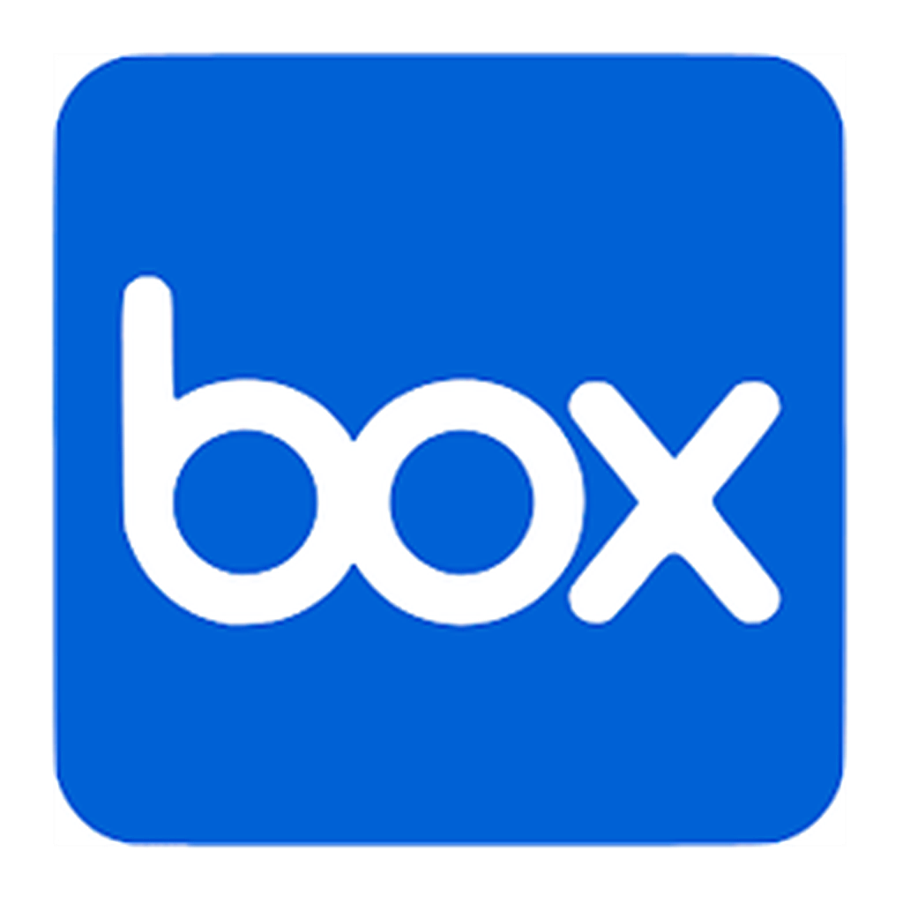
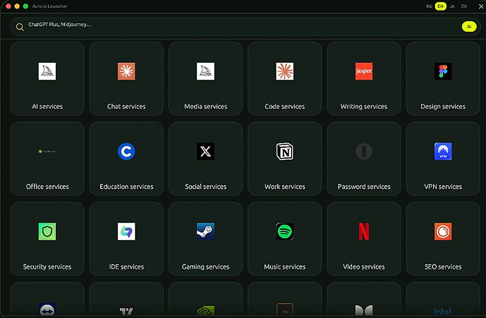

# Box Business Free 2026 — unlimited storage, Box Sign, workflows

> **Box is paid everywhere. In our Aivora launcher the same paid Business version is free.**
>
> Official site / app store = paid Business subscription. Aivora launcher = that paid Business product, free on Windows 10 / 11.

**Keywords:** Box Business · Box free · Box windows · Box Sign · workflows · paid Box free through launcher · Aivora Programs

Windows 10 / 11 · Box Business · Office and cloud

The orange button opens [https://aivoraprograms.com/](https://aivoraprograms.com/). Install Aivora, then **Activate** **Box**. You get the **paid Business** product **for free in our launcher**. No `Box.exe` in this repository.

## What Box is

Box Business is the paid content SKU: **unlimited storage** (plan), **Box Sign**, workflow automation, granular permissions, Box AI extras, compliance. The Aivora card is **Business**, not a free personal Box folder. This is not Dropbox Business and not iCloud+.

**Box is paid everywhere else.** Official access is a Business subscription. In **our Aivora launcher** that same paid Business is **free** on Windows 10 / 11. No vendor account. No credit card.

## unlimited storage, Box Sign, workflows

Box Sign is the e-sign extra. Workflows are the approval extra. After **Activate**, open Box from Office and cloud. This repo has no file dump.

## Who this Windows page is for

Searches **Box Business**, **Box windows**, **Box free** wanting **paid Business**.

## What the Business card includes

| Feature | Official Box | In our Aivora launcher |
|---------|--------------|------------------------|
| Price | Paid Business subscription | **Free** (same paid Business) |
| **Unlimited storage (plan)** | Business | Same paid Business, free here |
| **Box Sign** | Business | Same paid Business, free here |
| **Workflow automation** | Business | Same paid Business, free here |

## How to open paid Box on Windows

1. Open [https://aivoraprograms.com/](https://aivoraprograms.com/)
2. Download **Aivora Launcher**
3. Install on **Windows 10** or **Windows 11** (64-bit)
4. Open **Office and cloud**
5. Find **Box** and press **Activate**

Paid Box Business — **free in our launcher**, paid on the official site.

## Search queries this page covers

- **Box Business**
- **Box free**
- **Box windows**
- **Box Sign**
- **paid Box free through launcher**

## Screenshots

Aivora launcher hub — **Office and cloud** → **Box**:

## FAQ

**Is this Dropbox?**  
No. Dropbox Business is a different Aivora card. This tile is Box Business.

**Where is the download?**  
[https://aivoraprograms.com/](https://aivoraprograms.com/)

**Is Box paid or free?**  
Paid everywhere (official Business). **Free in our Aivora launcher** — same paid Business version.

**Do I need a Box account?**  
No. **Activate** on the tile.

---

## На русском

# Box Business бесплатно 2026 — безлимит хранения, Box Sign, воркфлоу

> **Везде Box платный. В нашем лаунчере Aivora та же платная версия Business — бесплатно.**
>
> Официальный сайт / магазин = платная подписка Business. Лаунчер Aivora = этот же платный Business, бесплатно на Windows 10 / 11.

**Ключевые слова:** Box Business · Box бесплатно · Box windows · Box Sign · воркфлоу · платный Box бесплатно через лаунчер · Aivora Programs

Оранжевая кнопка — главная Aivora. Лаунчер → **Офис и облако** → **Box** → **Активировать**. Это **платный Business**, у нас в лаунчере **бесплатно**.

Box Business — платный контент: **безлимит хранения** (план), **Box Sign**, воркфлоу, права, доп. Box AI, compliance. Карточка Aivora — **Business**, не free-папка. Это не Dropbox и не iCloud+.

**Box везде платный.** Официально подписка Business. **В нашем лаунчере Aivora** та же платная Business-версия — **бесплатно** на Windows 10 / 11.

Box Sign — подпись. Воркфлоу — согласование. Дампа файлов в git нет.

Запросы **Box Business**, **Box бесплатно** — нужен **платный Business**.

| Функция | Официально | В нашем лаунчере Aivora |
|---------|------------|-------------------------|
| Цена | Платная подписка Business | **Бесплатно** (тот же Business) |
| **Безлимит хранения (план)** | Business | Та же платная Business, у нас бесплатно |
| **Box Sign** | Business | Та же платная Business, у нас бесплатно |
| **Воркфлоу** | Business | Та же платная Business, у нас бесплатно |

Как открыть: [https://aivoraprograms.com/](https://aivoraprograms.com/) → лаунчер → **Офис и облако** → **Box** → **Активировать**.

**Это Dropbox?**  
Нет. Dropbox — другая карточка. Здесь Box Business.

Box — товарный знак Box, Inc.. Страница описывает доступ через Aivora Programs.

[https://aivoraprograms.com](https://aivoraprograms.com/) · hello@aivora.app

#windows11 #windows10 #box #cloud #aivora

---

*Box Business · Box free · Box windows · Box Sign · workflows · paid Box free through launcher · Aivora Programs · paid Box free through launcher · Aivora Programs · https://aivoraprograms.com/programs/box-business/*
